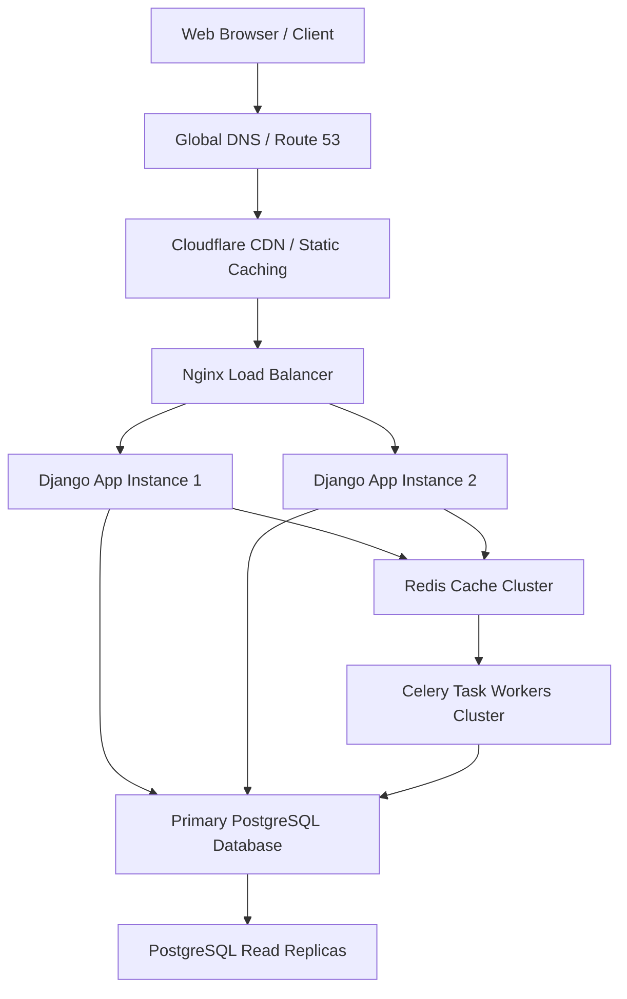

# System Design Interview Prep

This module uses **pretalx's** actual production features to teach advanced System Design concepts, preparing you to answer complex architecture questions in enterprise engineering interviews.

---

## Scenario: Design a Multi-Tenant Conference Scheduling System

### The Interview Question
*"Design a system that allows multiple distinct conferences (tenants) to manage their schedules, accept talk submissions, invite reviewers, and coordinate time slots. How do you guarantee data isolation between tenants, manage background operations, and scale under sudden traffic spikes (like when CfPs close)?"*

---

## 🏗️ 1. How pretalx Solved It (The Baseline Architecture)

Pretalx uses a modular relational database architecture backed by strong application-level security isolation and asynchronous task workers.

### Data Isolation Boundary (Multi-Tenancy)
*   **The Problem:** Traditional SaaS setups rely on developers to filter query results manually, which easily leads to security leaks.
*   **The pretalx Solution:** Multi-tenancy is modeled within a single shared database (logical isolation). Every core model holds a ForeignKey link to the `Event` table. We enforce database-level boundaries globally using `django-scopes`. 
*   **Key Path:** [`src/pretalx/common/middleware/event.py`](file:///c:/Users/Owner/Desktop/grav1pretalx/pretalx/src/pretalx/common/middleware/event.py) intercepts the domain or slug context, binds it to thread-local memory, and forces all subsequent queries to filter within that event scope.

### Background Task Coordination
*   **The Problem:** Sending emails or generating PDF files synchronously during HTTP requests slows down response times and locks threads.
*   **The pretalx Solution:** We deploy **Celery** workers connected to **Redis** or a database-backed queue to run deferred, CPU-intensive tasks asynchronously (like queueing speaker acceptance emails).
*   **Key Path:** [`src/pretalx/celery_app.py`](file:///c:/Users/Owner/Desktop/grav1pretalx/pretalx/src/pretalx/celery_app.py).

### Transactional Mail Outbox
*   **The Problem:** If a background mail task fails, the data transitions successfully but the user gets no notification.
*   **The pretalx Solution:** We use the Transactional Outbox pattern. Emails are saved in the database as `QueuedMail` rows in the same transaction that updates the talk's state. A background worker periodically polls the table and delivers them, achieving at-least-once delivery.
*   **Key Path:** [`src/pretalx/mail/models.py`](file:///c:/Users/Owner/Desktop/grav1pretalx/pretalx/src/pretalx/mail/models.py).

---

## 🚀 2. How to Scale This Architecture to 100x Traffic

To scale this baseline architecture for top-tier global tech conferences, we must evolve the infrastructure to handle millions of reads/writes.

### Strategy A: Cache Reads Aggressively (CDN + Redis)
1.  **Public Agenda Caching:** During an active conference, thousands of users hit `/talk/{code}` and `/schedule/`. This is 99% read traffic. We configure a Content Delivery Network (CDN) to cache all HTML agenda pages at the edge.
2.  **Object Caching:** We use a **Redis** cluster to cache hot database querysets (such as room layouts, event features, and speaker profiles). We use Django's `@cached_property` to cache query results locally within a single request.

### Strategy B: Database Sharding & Read Replicas
1.  **Read Replicas:** We separate database read and write traffic. All admin panel submissions go to the Primary PostgreSQL database, while public agenda views route to Read Replicas.
2.  **Tenant-Based Sharding:** Since data belongs strictly to a specific Event tenant, we can scale out database layers horizontally by sharding databases by `event_id`. Event A's data resides on DB-1, while Event B's resides on DB-2.

### Strategy C: Celery Queue Partitioning
1.  During peak hours (like a major Call for Proposals deadline), the celery queue gets flooded with acknowledgment email tasks.
2.  We partition queues into three separate brokers:
    *   `high-priority`: Handles instantaneous tasks like user registration and password resets.
    *   `default`: Handles standard submissions and review scoring updates.
    *   `bulk-mail`: Handles heavy, non-urgent tasks like mass organizer news mailers.

---

## 🏆 System Design Interview Checklist

When designing similar SaaS systems in your interviews, always cover these key dimensions:
*   **Data Model:** Isolate tenants using relational fields (`event_id`) with appropriate index patterns to keep search fast.
*   **Consistency:** Keep state changes robust using atomic transactions to prevent double-booking or orphan records.
*   **Resiliency:** Implement retries with exponential backoff on all email delivery pipelines.
*   **Latency:** Offload PDF generation and large exports to process queues.
