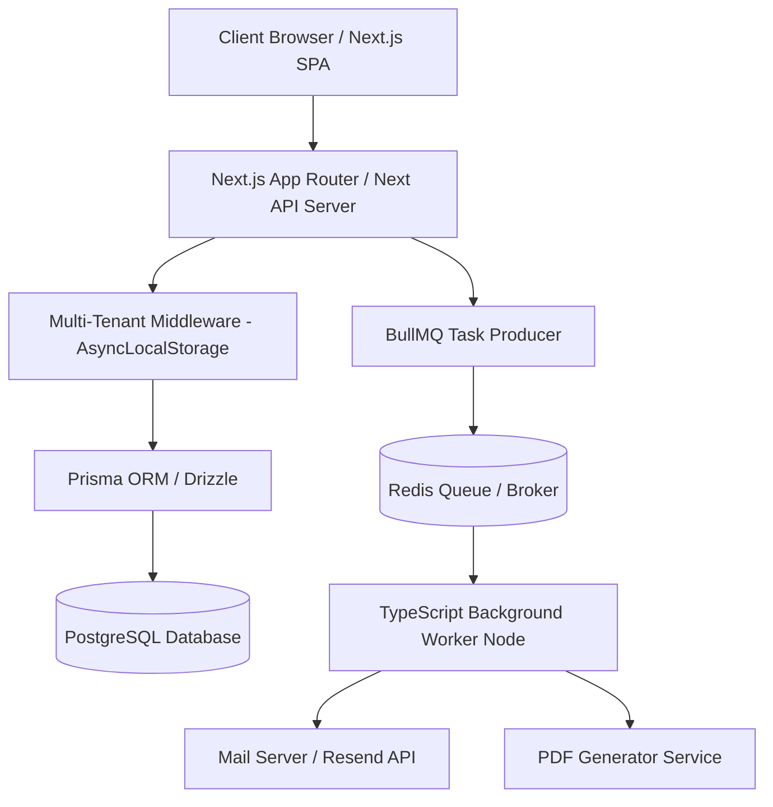

# Pure JS/TS System Architecture Specification

This document details the software architecture, data isolation patterns, and background worker systems for the pure JavaScript/TypeScript rewrite of **pretalx**.

---

## 🏗️ 1. Overall System Architecture Diagram



---

## 🔒 2. Multi-Tenant Scoping (TS `AsyncLocalStorage` Pattern)

In Django, multi-tenant isolation is enforced via thread-locals in `django-scopes`. In Node.js, we enforce database isolation globally using **`AsyncLocalStorage`** in combination with Prisma client middlewares or Drizzle query filters.

### The TS Scope Context Middleware
```typescript
import { AsyncLocalStorage } from 'async_hooks';
import { Request, Response, NextFunction } from 'express';

export interface TenantContext {
  eventId: string;
}

export const tenantStorage = new AsyncLocalStorage<TenantContext>();

export function tenantScopingMiddleware(req: Request, res: Response, next: NextFunction) {
  const eventSlug = req.params.eventSlug;
  if (!eventSlug) return next();

  // 1. Fetch eventId from database cache
  const eventId = getEventIdFromSlug(eventSlug); 

  // 2. Wrap execution in active tenant context
  tenantStorage.run({ eventId }, () => {
    next();
  });
}
```

### The Scoped Prisma Query Client
```typescript
import { PrismaClient } from '@prisma/client';
import { tenantStorage } from './middleware';

const prisma = new PrismaClient();

export const scopedDb = prisma.$extends({
  query: {
    submission: {
      async $allOperations({ model, operation, args, query }) {
        const context = tenantStorage.getStore();
        if (!context) {
          throw new Error("ScopeError: Attempted database query outside active tenant context!");
        }
        // Enforce eventId filtering globally
        args.where = {
          ...args.where,
          eventId: context.eventId,
        };
        return query(args);
      },
    },
  },
});
```

---

## 🗃️ 3. Target Database Entity-Relationship Mapping (Prisma Schema)

```prisma
datasource db {
  provider = "postgresql"
  url      = env("DATABASE_URL")
}

generator client {
  provider = "prisma-client-js"
}

model Event {
  id          String       @id @default(uuid())
  slug        String       @unique
  name        String
  dateFrom    DateTime
  dateTo      DateTime
  submissions Submission[]
  tracks      Track[]
  createdAt   DateTime     @default(now())
}

model Track {
  id          String       @id @default(uuid())
  eventId     String
  event       Event        @relation(fields: [eventId], references: [id], onDelete: Cascade)
  name        String
  color       String       @default("#3498db")
  submissions Submission[]
}

model Submission {
  id          String           @id @default(uuid())
  eventId     String
  event       Event            @relation(fields: [eventId], references: [id], onDelete: Cascade)
  trackId     String?
  track       Track?           @relation(fields: [trackId], references: [id], onDelete: SetNull)
  code        String           @unique
  title       String
  abstract    String
  state       SubmissionState  @default(DRAFT)
  speakers    SpeakerRole[]
  reviews     Review[]
  createdAt   DateTime         @default(now())
}

enum SubmissionState {
  DRAFT
  SUBMITTED
  ACCEPTED
  REJECTED
  CONFIRMED
  CANCELED
  WITHDRAWN
}

model User {
  id        String        @id @default(uuid())
  email     String        @unique
  name      String
  roles     SpeakerRole[]
  reviews   Review[]
}

model SpeakerRole {
  id           String     @id @default(uuid())
  submissionId String
  submission   Submission @relation(fields: [submissionId], references: [id], onDelete: Cascade)
  userId       String
  user         User       @relation(fields: [userId], references: [id], onDelete: Cascade)
}

model Review {
  id           String     @id @default(uuid())
  submissionId String
  submission   Submission @relation(fields: [submissionId], references: [id], onDelete: Cascade)
  userId       String
  user         User       @relation(fields: [userId], references: [id], onDelete: Cascade)
  score        Float
  text         String?
  isDraft      Boolean    @default(false)
}
```

---

## 📬 4. Background Workers & Queue Management (BullMQ)

Replacing Celery, we leverage **BullMQ** running on **Redis** to dispatch asynchronous workflows.

### Job Producer
```typescript
import { Queue } from 'bullmq';
import IORedis from 'ioredis';

const connection = new IORedis(process.env.REDIS_URL);
export const mailQueue = new Queue('MailQueue', { connection });

export async function queueSpeakerNotification(email: string, submissionCode: string) {
  await mailQueue.add('send-state-email', {
    to: email,
    code: submissionCode,
  }, {
    attempts: 3,
    backoff: { type: 'exponential', delay: 5000 },
  });
}
```

### Job Consumer (Worker)
```typescript
import { Worker, Job } from 'bullmq';
import IORedis from 'ioredis';

const connection = new IORedis(process.env.REDIS_URL);

const worker = new Worker('MailQueue', async (job: Job) => {
  if (job.name === 'send-state-email') {
    const { to, code } = job.data;
    // Render and dispatch mail
    await sendTransactionalEmail(to, code);
  }
}, { connection });
```
