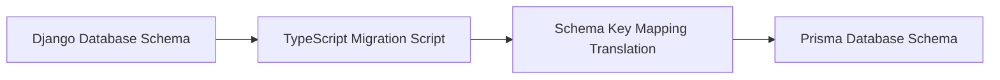

# Subtasks Roadmap & Schema Data Migration Plan

This document outlines the operational roadmap, partitioned into agile sprints, to migrate the **pretalx** platform to a TypeScript and React ecosystem, followed by a database migration strategy.

---

## 🗺️ 1. Project Roadmap & Sprints

### Sprint 1: Foundation & Scoped Database Layers (Week 1–2)
*   **[ ] Subtask 1.1:** Setup NestJS/Next.js backend project structure, ESLint, Prettier, and TypeScript compilation targets.
*   **[ ] Subtask 1.2:** Initialize Prisma ORM / Drizzle configurations and define core schema entities (Event, User, Submission, Track).
*   **[ ] Subtask 1.3:** Build `tenantScopingMiddleware` using Node.js `AsyncLocalStorage` and register it globally inside API request lifecycles.
*   **[ ] Subtask 1.4:** Construct unit tests validating database scope exceptions (asserting query failures when AsyncLocalStorage store context is empty).

### Sprint 2: Authentication & Core CfP Wizard API (Week 3–4)
*   **[ ] Subtask 2.1:** Implement JSON Web Token (JWT) stateless auth controllers using HTTP-Only cookies.
*   **[ ] Subtask 2.2:** Build multi-step CfP wizard state API endpoints (saving draft data sequentially inside Redis memory stores).
*   **[ ] Subtask 2.3:** Recreate rules-based permission gates (translating permission predicates into standalone TypeScript middleware modules).
*   **[ ] Subtask 2.4:** Write integration tests verifying step-by-step submission completions.

### Sprint 3: Organizer Dashboard & Visual Schedule API (Week 5–6)
*   **[ ] Subtask 3.1:** Recreate Svelte schedule visual planner endpoints in TypeScript, loading and reconciling `TalkSlot` intersections.
*   **[ ] Subtask 3.2:** Develop the Next.js React administrator panel listing talks, filters, and state transition controllers (`setSubmissionState`).
*   **[ ] Subtask 3.3:** Integrate BullMQ and Redis task workers to execute background outbox email rendering.

### Sprint 4: Public Agenda & Visual Timetable App (Week 7–8)
*   **[ ] Subtask 4.1:** Build highly-optimized public conference pages (Schedule Grid, Speaker Directory, Talk details) using Next.js Server Components (RSC) for instantaneous edge-loading speeds.
*   **[ ] Subtask 4.2:** Construct React client widgets displaying live countdowns to CfP closing deadlines.

---

## 🗄️ 2. Database Schema Migration Strategy

To safely migrate a production database from the legacy Django schema to the new Prisma TypeScript schema without losing historical data, follow this step-by-step data mapping blueprint.



### Table Mapping Dictionary

| Source Django Table | Target Prisma Table | Column Conversions & Gotchas |
| :--- | :--- | :--- |
| `pretalx_event_event` | `Event` | Straight copy. Convert timezone date formats. |
| `pretalx_submission_submission` | `Submission` | Map Django state integer strings (e.g. `submitted`, `accepted`) directly to Prisma enum keys `SUBMITTED`, `ACCEPTED`. |
| `pretalx_submission_track` | `Track` | Map foreign keys `event_id` to `eventId`. |
| `pretalx_person_user` | `User` | Map email profiles, hashing passwords separately if upgrading auth providers. |

### The TypeScript Data Migrator Script
Write this migration CLI utility in `tools/data-migrator.ts` to run a chunked, atomic copy of historical rows:
```typescript
import { PrismaClient as LegacyClient } from './legacy-client';
import { PrismaClient as NextClient } from './next-client';

const legacyDb = new LegacyClient();
const nextDb = new NextClient();

async function runDataMigration() {
  console.log("Starting database data migration...");
  
  // 1. Migrate Events
  const events = await legacyDb.djangoEvent.findMany();
  for (const e of events) {
    await nextDb.event.upsert({
      where: { slug: e.slug },
      update: {},
      create: {
        id: e.uuid,
        slug: e.slug,
        name: e.name,
        dateFrom: new Date(e.date_from),
        dateTo: new Date(e.date_to),
      }
    });
  }
  console.log("Events migrated.");
  // Follow same chunked upsert procedure for tracks, users, and submissions
}
```
Run the migrator inside a maintenance downtime window:
```powershell
npx ts-node tools/data-migrator.ts
```
